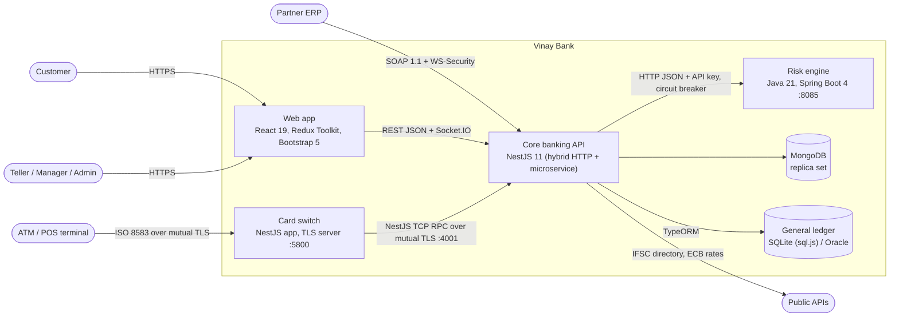
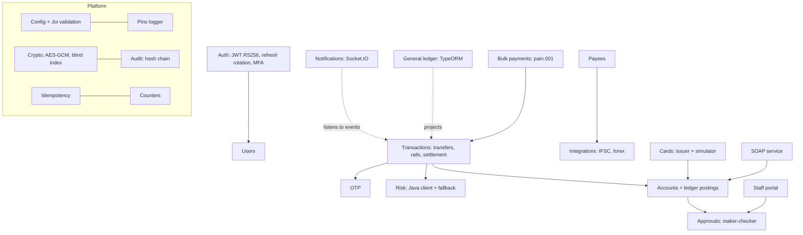
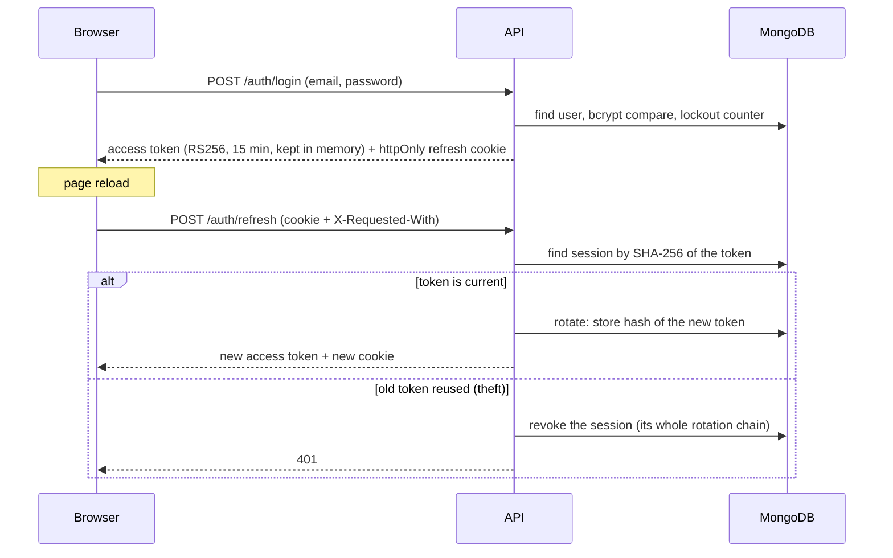
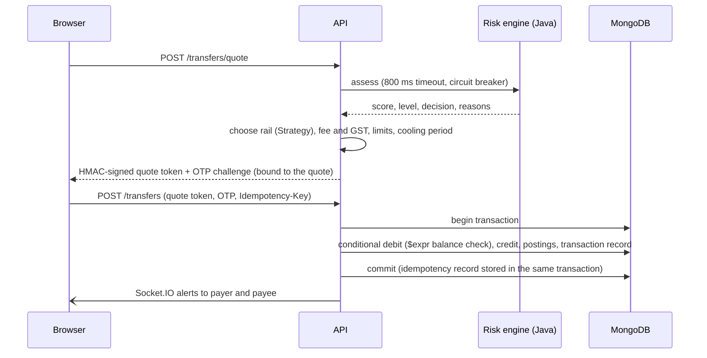
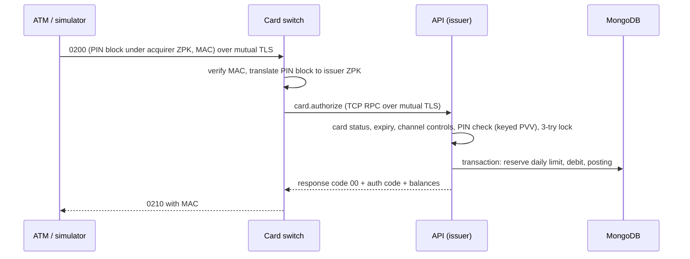
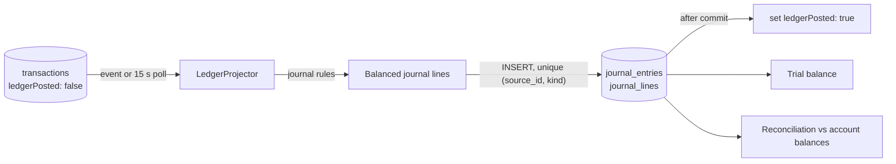

# Architecture

Vinay Bank is a modular monolith for core banking (NestJS + MongoDB) surrounded by
three independently deployable services that a bank really runs separately: a
card switch, a fraud risk engine and a relational general ledger.

## System context

| Component | Code | Runs as | Talks |
|---|---|---|---|
| Web app | `frontend/` | Vite dev server or static files behind nginx | REST/JSON, WebSocket |
| Core banking API | `backend/apps/api` | Node.js process (port 4000 HTTP, 4001 RPC) | REST, Socket.IO, SOAP, TCP RPC, HTTP client |
| Card switch | `backend/apps/card-switch` | Separate Node.js process (port 5800) | ISO 8583 over TLS, NestJS ClientProxy |
| Shared library | `backend/libs/shared` | Compiled into both NestJS apps | ISO 8583 codec, crypto, money, banking utilities |
| Risk engine | `services/risk-engine` | JVM (port 8085) | REST/JSON |
| Databases | MongoDB, SQLite/Oracle | | |

## Core banking API: module map

The API is split into NestJS feature modules with explicit imports and
exports. Cross-module side effects go through domain events, not direct calls.

## Request pipeline

Every HTTP request passes the same chain, configured once in `app.setup.ts`
and `app.module.ts`:

1. `requestIdMiddleware` (X-Request-Id, reused in logs and errors)
2. Helmet security headers, compression, cookie parser
3. Body parsers with small limits; malformed JSON becomes a `MALFORMED_REQUEST` error
4. CORS allow-list
5. Guards in order: `ThrottlerGuard` (rate limit) then `JwtAuthGuard` then `RolesGuard`
6. Pipes: `MongoSanitizePipe` (strips `$` and `.` keys) then `ValidationPipe` (whitelist, forbid unknown)
7. Controller and service
8. `ResponseEnvelopeInterceptor` wraps results as `{ success, data, meta }`
9. `AllExceptionsFilter` turns every error into `{ success: false, error: { code, message, details }, requestId }`

## Key flows

### Sign-in with refresh token rotation

### Transfer: quote, OTP, atomic execution

### ATM withdrawal through the card switch

### Ledger projection (MongoDB to SQL)

## Data model

**MongoDB** (operational data, Mongoose schemas with indexes):

| Collection | Notes |
|---|---|
| `users` | Customers and staff; PAN encrypted (AES-256-GCM) with a blind index; MFA secret encrypted |
| `sessions` | SHA-256 of the current and previous refresh token, device, expiry, revocation reason |
| `accounts` | Balances in paise (`ledgerBalance`, `holdAmount`), limits, status |
| `postings` | Statement lines with running balance |
| `transactions` | Every money movement: rail, status (state machine), risk, metadata |
| `beneficiaries` | Payees with a cooling period |
| `approvals` | Maker-checker requests |
| `cards` | Encrypted PAN, blind index, keyed PIN verification value, controls, limits, usage |
| `bulk_batches` | Accepted pain.001 files (unique message ID per customer) |
| `idempotency_keys`, `otp_challenges`, `notifications`, `counters` | Supporting data, TTL indexes where relevant |
| `audit_logs` | Append-only, SHA-256 hash chain |

**SQL** (general ledger): `gl_accounts`, `journal_entries` (unique `source_id + kind`),
`journal_lines` (CHECK: debit or credit, never both, never negative). See
`database/oracle/01_schema.sql`.

Money is always an integer number of **paise** (no floating point anywhere).

## Design patterns and where they are

| Pattern | Where |
|---|---|
| Strategy | Payment rails (`transactions/rails/payment-rails.ts`); fraud rules in Java (`FraudRules`, `RiskRule`) and TypeScript (`risk-rules.ts`) |
| Registry | Approval handlers keyed by request type (`approvals.service.ts`) |
| State machine | Transaction status transitions (`transaction-state.ts`) |
| Observer / domain events | `EventEmitter2` events drive notifications and the ledger projector |
| Circuit breaker | `common/resilience/circuit-breaker.ts` around the Java risk engine |
| Idempotent consumer / outbox | Ledger projector; Idempotency-Key on transfers, cash and bulk payments |
| Adapter | SOAP service over the same domain services; acquirer client over raw TLS |
| Template / pipeline | NestJS guards, pipes, interceptors, filters |
| Repository | Mongoose models and TypeORM repositories injected into services |
| Dependency injection | NestJS and Spring containers |

## Why these choices

- **Modular monolith first.** Banking domains share transactions (a transfer
  touches accounts, postings, approvals and audit). One NestJS process with
  strong module boundaries keeps ACID transactions simple; the services that
  have a real reason to be separate (the switch, the risk engine) are separate.
- **MongoDB replica set** for multi-document transactions, plus SQL for the
  ledger where joins, constraints and reporting are natural: polyglot
  persistence, each store doing what it is best at.
- **Hybrid NestJS app.** The API serves HTTP for people and a mutual-TLS TCP
  microservice for the switch from one codebase.
- **Two engines, one rule set.** The Java engine can evolve independently
  (models, more data); the in-process fallback guarantees availability.
