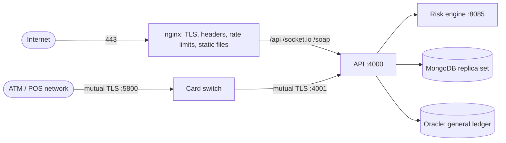

# Deployment

> **What was run.** Docker Compose was run end to end on Docker Desktop
> (Docker 29.9, Windows 11): all five containers start; the web app works
> through nginx; live notifications arrive over WebSockets; the ATM CLI and
> the SOAP client talk to the containers; the API reaches the Java risk engine
> with its API key. The nginx edge configuration, the systemd units, the PM2
> file and the Oracle scripts follow standard practice but were **not run**
> (there was no Linux server, nginx or Oracle in the development environment).
> Treat those as a reviewed starting point.

## Topology



Only nginx (443) and the card switch (5800, mutual TLS, ideally on a private
network for acquirers) are exposed. The API, the issuer RPC port, the risk
engine and the databases stay on internal networks.

## Option 1: Docker Compose

```bash
npm install                    # creates backend/.env and backend/.secrets
docker compose up -d --build   # MongoDB, API, card switch, risk engine, web app
```

Open http://localhost:8080; the demo sign-ins work as in development. The
first build downloads about 1.5 GB of base images and packages and takes a few
minutes; later builds reuse the cache.

- **Stop `npm run dev` first**: both publish the card switch on port 5800.
- Only nginx (8080) and the card switch (5800) are published. The API, MongoDB
  and the risk engine are reachable only inside the Compose network.
- Point the terminal clients at the containers:

```bash
npm run atm -- balance --demo --pin 4826 --api http://localhost:8080/api/v1
npm run soap -- security --url http://localhost:8080/soap/banking
```

- Logs: `docker compose logs -f api card-switch` (JSON lines from both).
- Stop with `docker compose down`. Add `-v` to delete the database and ledger
  volumes; the demo data is seeded again on the next start.

Files: `docker-compose.yml`, `backend/Dockerfile` (one image, two commands: API
and card switch), `frontend/Dockerfile` (build, then unprivileged nginx),
`services/risk-engine/Dockerfile` (Maven build, then a JRE image running as a
non-root user). The MongoDB health check initiates the replica set on first
start. Secrets are mounted read-only, never baked into images. The Maven
Wrapper checks the Maven download against a pinned SHA-256; the build stage
installs `unzip` because without it the wrapper fetches the `.tar.gz`, whose
checksum differs from the pinned `.zip`.

## Option 2: Linux server (systemd)

1. Install Node.js 22 LTS, Java 21, nginx and MongoDB (3-node replica set in production).
2. Create a service user: `sudo useradd --system --home /opt/vinaybank vinaybank`.
3. Build: `npm ci && npm run build`, and `./mvnw -B package` in `services/risk-engine`.
4. Copy `backend/dist`, `backend/package*.json` (then `npm ci --omit=dev`),
   `backend/.env`, `backend/.secrets` and the risk engine jar to `/opt/vinaybank`.
   Restrict permissions: `chmod 600 .env`, `chmod 700 .secrets`.
5. Install the units from `deploy/systemd/` and start them:

```bash
sudo cp deploy/systemd/*.service /etc/systemd/system/
sudo systemctl daemon-reload
sudo systemctl enable --now vinaybank-api vinaybank-switch vinaybank-risk
journalctl -u vinaybank-api -f
```

The units run as the unprivileged user with `ProtectSystem=strict`,
`NoNewPrivileges`, a private `/tmp` and no capabilities; only the data folder is
writable.

6. Build the web app (`npm --prefix frontend run build`), copy `frontend/dist`
   to `/var/www/vinaybank`, install `deploy/nginx/vinaybank.conf` and the proxy
   snippet in it, get a certificate (for example with certbot) and reload nginx.

**PM2** is an alternative to systemd: `pm2 start deploy/pm2/ecosystem.config.cjs`
(the file explains why the API runs as a single process).

## Production settings

| Setting | Value |
|---|---|
| `NODE_ENV` | `production` |
| `COOKIE_SECURE` | `true` (HTTPS only) |
| `TRUST_PROXY` | `1` behind one proxy, so rate limits and audit logs see real client IPs |
| `CORS_ORIGINS` | The exact public origin |
| `DEMO_MODE`, `SEED_DEMO_DATA` | `false` |
| `MONGODB_URI` | A replica set with authentication and TLS |
| `LEDGER_DB_TYPE` | `oracle` with the schema from `database/oracle` |
| Secrets | From a vault or KMS rather than files; the card keys in an HSM |
| Certificates | The card network CA and certificates from the bank's PKI, not the development CA |

## Operations

- **Health**: `GET /api/v1/health` (liveness) and `/api/v1/health/ready`
  (readiness, checks MongoDB); the risk engine has `/actuator/health`.
- **Logs**: JSON lines (pino) with request IDs, ready for a log pipeline.
- **Graceful shutdown**: SIGTERM closes listeners and finishes in-flight work
  (NestJS shutdown hooks, Spring `server.shutdown: graceful`).
- **Backups**: MongoDB (oplog-based), Oracle RMAN; the SQL ledger can also be
  rebuilt from MongoDB because it is a projection.
- **Scaling**: the API is stateless apart from Socket.IO and the SQLite ledger;
  with Oracle and the Socket.IO Redis adapter it can run several instances
  behind nginx.
