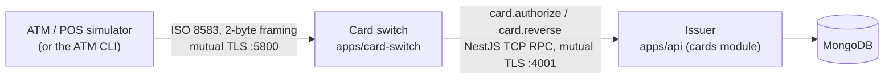

# ISO 8583 card network

Vinay Bank runs its own small card network: a simulated ATM and shop terminal
(acquirer), a **card switch** and the core banking **issuer**.



## Messages

| MTI | Name | Used for |
|---|---|---|
| 0200 / 0210 | Financial transaction request / response | Balance inquiry, cash withdrawal, purchase |
| 0420 / 0430 | Reversal advice / response | "Cash not dispensed", cancelled payment |
| 0800 / 0810 | Network management request / response | Echo test (field 70 = 301), sign-on |

Processing code (field 3): `31` balance inquiry, `01` cash withdrawal, `00` purchase.

## Encoding (`libs/shared/src/iso8583`)

- **MTI**: 4 ASCII digits.
- **Bitmap**: 8 binary bytes for fields 1-64; bit 1 set means a second bitmap
  for fields 65-128 follows. Example: a 0800 with fields 7, 11 and 70 has bitmap
  `8220000000000000 0400000000000000`.
- **Fields**: ASCII; fixed numeric fields left-padded with zeros, fixed text
  right-padded with spaces; LLVAR/LLLVAR fields carry a 2 or 3 digit length
  prefix (the PAN in field 2 is `16` + 16 digits); binary fields (PIN block,
  MAC) are raw bytes.
- **Framing**: each message is preceded by a 2-byte big-endian length. TCP has no
  message boundaries, so `FrameDecoder` buffers bytes until a whole frame has
  arrived (the tests feed it 7 bytes at a time).

Data elements in use:

| Field | Name | Format |
|---|---|---|
| 2 | Primary account number | n..19 LLVAR |
| 3 | Processing code | n6 |
| 4 | Amount (paise) | n12 |
| 7 | Transmission date and time (UTC, MMDDhhmmss) | n10 |
| 11 | System trace audit number (STAN) | n6 |
| 12, 13 | Local time and date (India) | n6, n4 |
| 14 | Expiry (YYMM) | n4 |
| 18 | Merchant category code (6011 = ATM) | n4 |
| 22 | POS entry mode (051 = chip and PIN) | n3 |
| 25 | POS condition code | n2 |
| 32 | Acquiring institution ID | n..11 LLVAR |
| 37 | Retrieval reference number | an12 |
| 38 | Authorization code | an6 |
| 39 | Response code | an2 |
| 41, 42, 43 | Terminal ID, acceptor ID, acceptor name and location | ans8, ans15, ans40 |
| 49 | Currency (356 = INR) | n3 |
| 52 | PIN block | b8 |
| 54 | Additional amounts (ledger and available balance) | ans..120 LLLVAR |
| 64 / 128 | Message authentication code | b8 |
| 70 | Network management code | n3 |
| 90 | Original data elements (reversals) | n42 |

## PIN security

**PIN block, ISO 9564 format 0.** PIN field `0 | length | PIN | F padding`, XOR
the PAN field `0000 | 12 rightmost PAN digits without the check digit`. With
PIN 1234 and PAN 4111 1111 1111 1111:

```
PIN field  04 12 34 FF FF FF FF FF
PAN field  00 00 11 11 11 11 11 11
PIN block  04 12 25 EE EE EE EE EE
```

(this exact value is a unit test). Binding the PAN means a captured block is
useless with another card.

**Zone keys.** The terminal encrypts the block with triple DES under the
**acquirer zone PIN key**. The switch decrypts it and re-encrypts it under the
**issuer zone PIN key** (PIN translation); the clear block exists only inside
`translatePinBlock` and is overwritten afterwards. The issuer decrypts it, reads
the PIN and compares a keyed verification value in constant time. The PIN is
never stored anywhere.

**MAC.** HMAC-SHA256 over every byte before the MAC field, truncated to 8 bytes,
placed in field 64 (or 128 when a secondary bitmap exists). The switch rejects a
bad MAC with response code 63, and the terminal checks the MAC of the response.

## Issuer decisions

| Code | Meaning | When |
|---|---|---|
| 00 | Approved | |
| 05 | Do not honour | Expiry date does not match |
| 12 | Invalid transaction | Unknown processing code or currency |
| 13 | Invalid amount | Not a multiple of Rs 100 at an ATM, zero amount |
| 14 | Invalid card number | No such card |
| 25 | Original not found | Reversal without a matching RRN and terminal |
| 30 | Format error | Missing mandatory fields |
| 41 | Lost card | Card hotlisted |
| 51 | Insufficient funds | |
| 54 | Expired card | |
| 55 | Incorrect PIN | |
| 57 | Not permitted to cardholder | Channel switched off (ATM or shops) |
| 61 | Exceeds amount limit | Daily ATM or POS limit (reserved atomically) |
| 62 | Restricted card | Blocked by the customer, or account frozen |
| 63 | Security violation | MAC failed (switch) |
| 75 | PIN tries exceeded | Third wrong PIN |
| 91 | Issuer inoperative | Issuer unreachable or too slow (switch) |
| 94 | Duplicate transmission | Same terminal and RRN twice (unique index) |
| 96 | System malfunction | Unexpected error |

A switch must always answer: if the issuer cannot be reached within the timeout,
the switch replies 91 instead of leaving the terminal waiting.

Approved withdrawals and purchases create a transaction (rail CARD) and postings
in one MongoDB transaction, so they appear on the statement, trigger a debit
alert and are posted to the SQL ledger. A reversal credits the money back, marks
the transaction REVERSED and releases the day's limit.

## Trying it

- **Browser**: http://localhost:5173/simulator, then "Use demo card" (PIN in the
  README). The message inspector shows each request and response: fields,
  bitmap, hex dump (cardholder data blanked) and the TLS session.
- **Terminal**:

```bash
npm run atm -- echo
npm run atm -- balance --demo --pin 4826
npm run atm -- withdraw --demo --pin 4826 --amount 500
```

- **Tests**: `libs/shared/src/iso8583/iso8583.spec.ts` (codec, framing, PIN block
  known answer, MAC) and `apps/api/test/cards.e2e-spec.ts` (the whole chain, a
  forged MAC, a client without a certificate).
